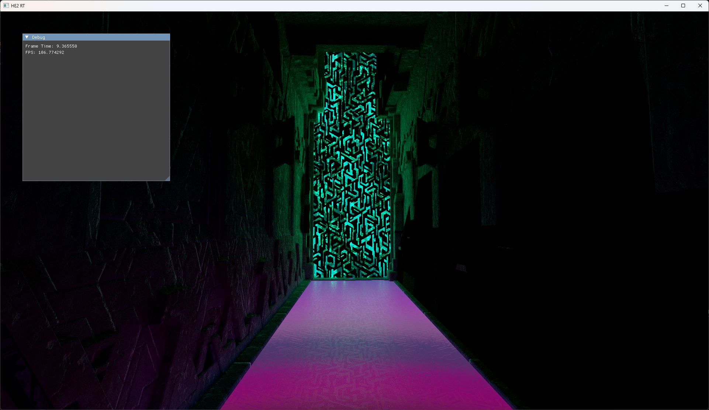
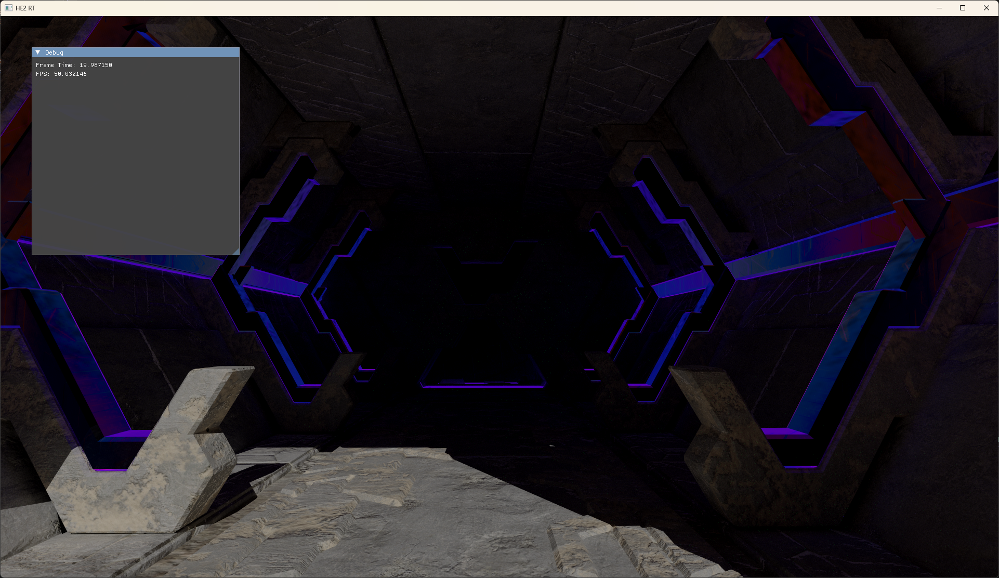
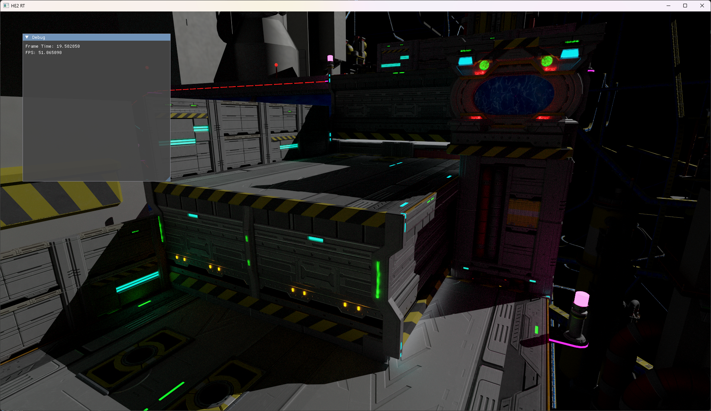
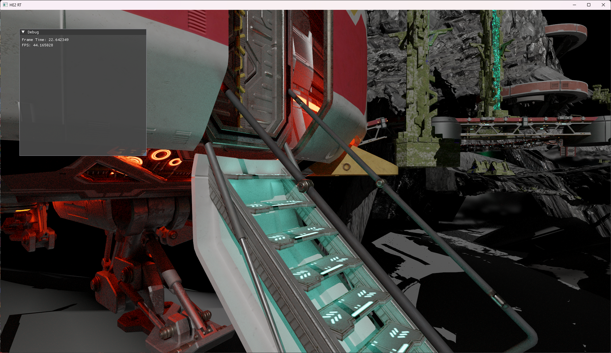
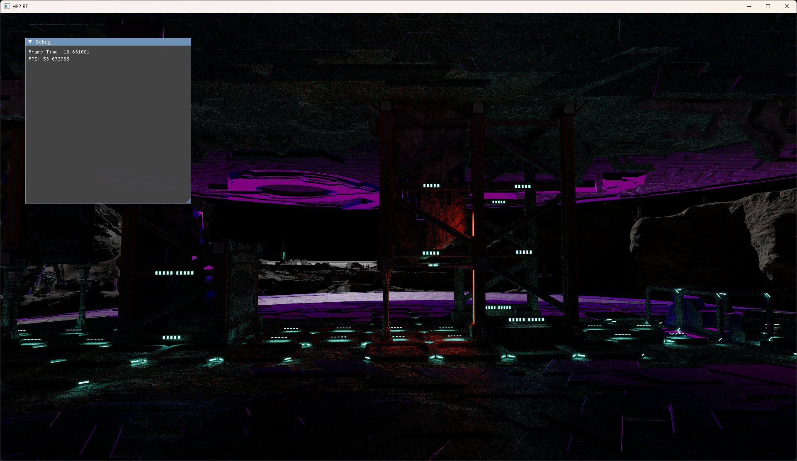
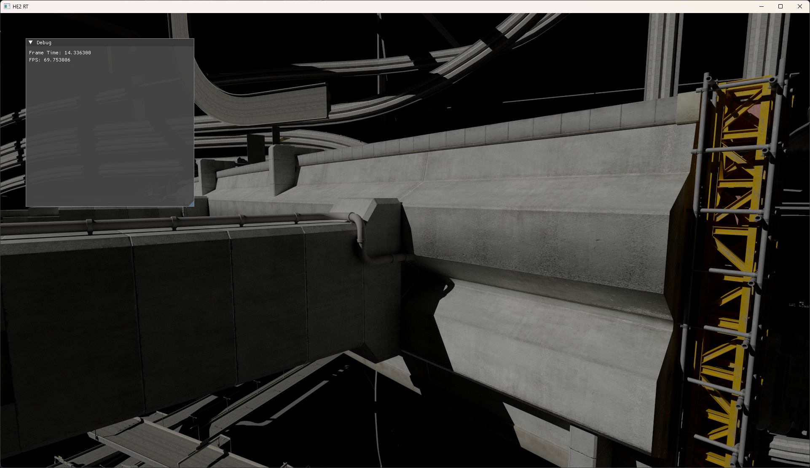
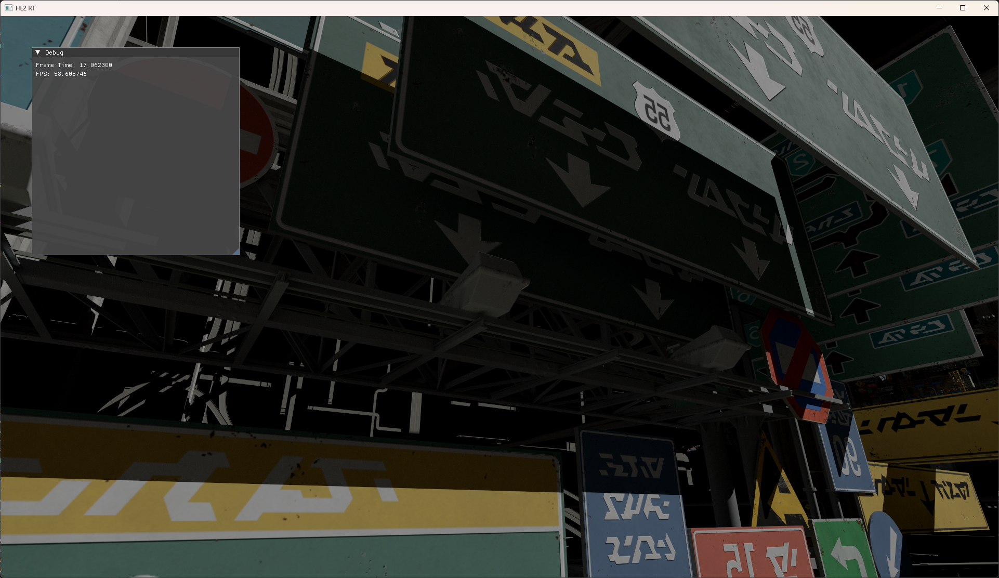
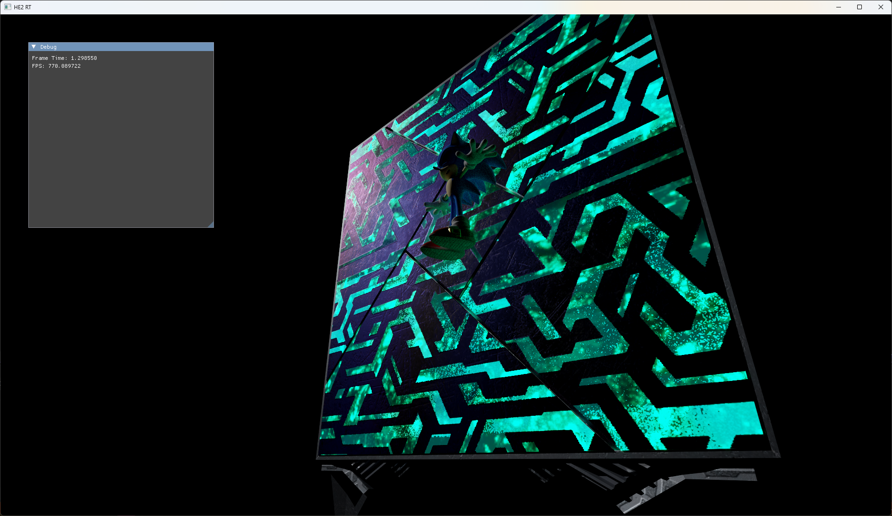
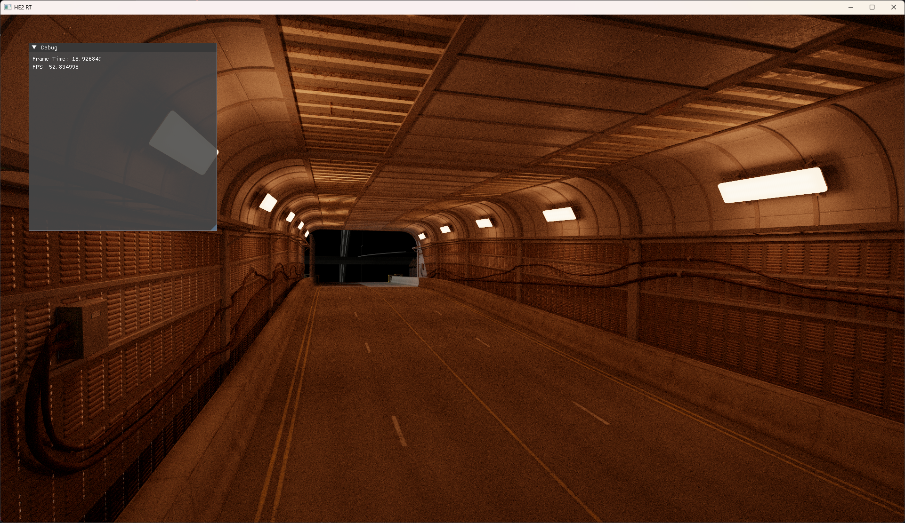
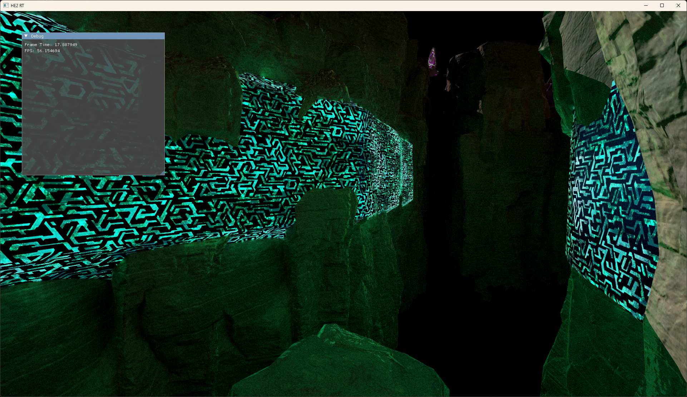

# HE2RT

HE2RT is an in development hardware accelerated path tracing renderer for Hedgehog Engine 2 built on the Vulkan API.
Once finished, it will be possible to use HE2RT both to bake lightmaps and
lightfields for custom stages, and as a replacement realtime renderer for Hedgehog Engine 2 games like Sonic Frontiers and Shadow Generations.

HE2 materials are accurately rendered using reverse engineered material shaders from the actual games.
Check out the "Screenshots" section for an example of the visuals that HE2RT can currently generate.

# Roadmap

The following features will be added shortly:

* Heightmap rendering
* Glass materials
* Local light support
* Baking of lightfields
* Baking of GI maps
* Atmosphere support

# Screenshots

